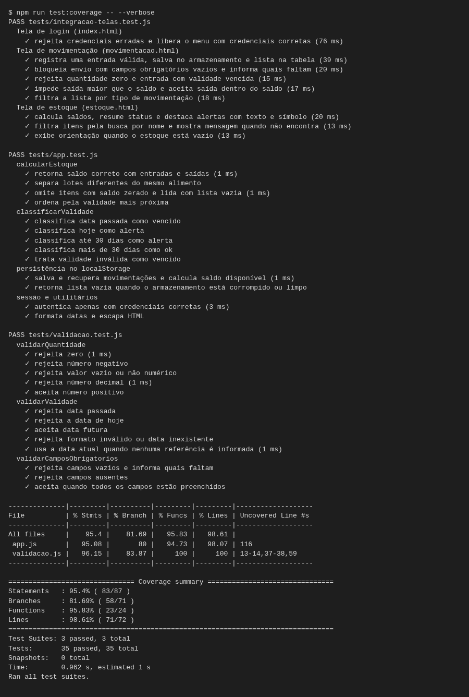
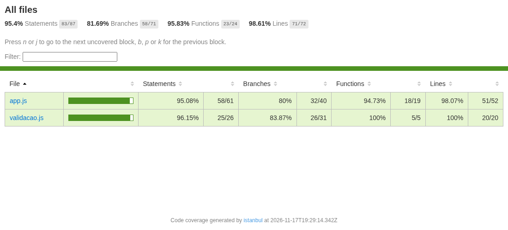
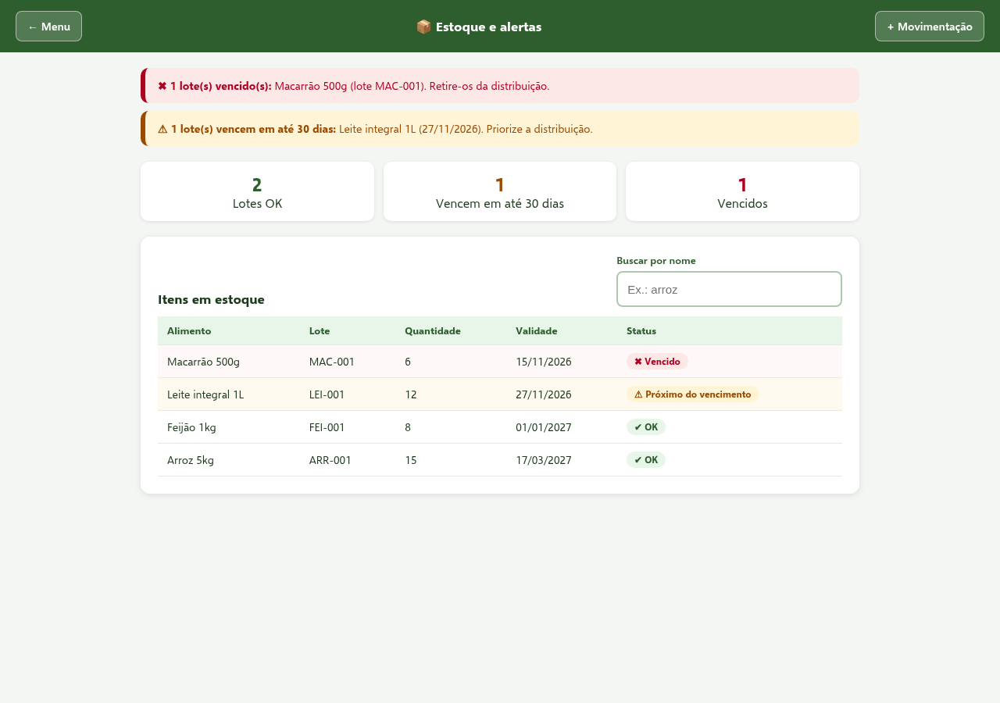

# Relatório de Testes, Integração Contínua e Acessibilidade

**Projeto:** Controle de Doações de Alimentos (MVP)
**Etapa:** Experiência Prática III, Etapa 3: Testes e integração contínua
**Data da execução:** 17/11/2026

---

## 1. Estratégia de testes

| Camada | Arquivo | Ferramenta | O que verifica | Qtd. |
|---|---|---|---|---|
| Unitário | `tests/validacao.test.js` | Jest | Funções puras de validação: campos obrigatórios, quantidade e validade | 13 |
| Integração (lógica + armazenamento) | `tests/app.test.js` | Jest + jsdom | Cálculo de estoque por lote, classificação de validade, persistência no `localStorage`, sessão | 13 |
| Integração (telas) | `tests/integracao-telas.test.js` | Jest + jsdom | Carrega os HTMLs reais, executa os scripts da página e simula o uso: login, registro, bloqueios, filtro, estoque e alertas | 9 |
| **Total** | | | | **35** |

### Cenários cobertos pelos testes de integração das telas

1. Login rejeita senha errada e libera o menu com `admin` / `1234`.
2. Entrada válida (arroz, lote **ARR-001**) é salva e aparece na lista.
3. Envio com campos vazios é bloqueado e a mensagem informa quais campos faltam.
4. Quantidade zero e entrada com validade vencida são rejeitadas.
5. Saída maior que o saldo é bloqueada; saída dentro do saldo é aceita.
6. Filtro da lista por tipo (entrada/saída).
7. Estoque calcula saldo (20 − 5 = 15), resume status e exibe alertas com **texto e símbolo** (✔ ⚠ ✖), além da cor.
8. Busca por nome no estoque e mensagem quando nada é encontrado.
9. Orientação exibida quando o estoque está vazio.

### Como executar

```bash
npm install
npm test               # executa os 35 testes
npm run test:coverage  # executa e gera o relatório de cobertura em coverage/
```

---

## 2. Resultado da execução local

```
Test Suites: 3 passed, 3 total
Tests:       35 passed, 35 total
```



## 3. Análise de cobertura

| Arquivo | Instruções | Ramificações | Funções | Linhas |
|---|---|---|---|---|
| `js/app.js` | 95,08% | 80,00% | 94,73% | 98,07% |
| `js/validacao.js` | 96,15% | 83,87% | 100% | 100% |
| **Total** | **95,40%** | **81,69%** | **95,83%** | **98,61%** |

**Limite mínimo configurado** (`coverageThreshold` no `package.json`): linhas 80%, instruções 80%, funções 80%, ramificações 70%. Se a cobertura cair abaixo disso, o comando falha e o CI fica vermelho.

**Pontos não cobertos e justificativa:**
- `app.js`, linha 116 (`exigirSessao`): faz o redirecionamento do navegador para o login, que o jsdom não executa. Nos testes de tela, a sessão é pré-carregada.
- `validacao.js`, linhas 13-14, 37-38 e 59: ramos defensivos para entradas de tipo inesperado (ex.: `null` no lugar de objeto).

> Observação: a cobertura é medida sobre os módulos de lógica (`js/app.js` e `js/validacao.js`). Os scripts de cada tela (`js/paginas/`, extraídos dos HTMLs no PR #2) são exercitados pelos testes de integração das telas, mas não entram na métrica.



---

## 4. Pipeline de Integração Contínua (GitHub Actions)

Arquivo: [`.github/workflows/ci.yml`](../../.github/workflows/ci.yml)

| Item | Configuração |
|---|---|
| Gatilhos | `push` e `pull_request` em qualquer branch |
| Ambiente | `ubuntu-latest`, Node.js 18 |
| Etapas | checkout → setup Node → `npm install` → `npm test` → `npm run test:coverage` |
| Critério de falha | qualquer teste falhando ou cobertura abaixo do limite |

**Primeira execução:** commit `9f4d1fc` (`ci: adiciona pipeline de integração contínua`), concluída com **sucesso**:
https://github.com/lborges7/Controle-de-Doa-es-de-Alimentos/actions/runs/44158279210

As execuções seguintes (incluindo as do Pull Request desta etapa) ficam listadas em:
https://github.com/lborges7/Controle-de-Doa-es-de-Alimentos/actions

---

## 5. Evidências de funcionamento do sistema

Capturas feitas com o sistema em execução no navegador (Chromium), em **desktop (1280 px)** e **celular (390 px)**. Todos os arquivos estão em [`img/`](img/).

| # | Situação | Desktop | Celular |
|---|---|---|---|
| 1 | Tela de login | [ver](img/01_login_desktop.png) | [ver](img/01_login_mobile.png) |
| 2 | Login com senha errada | [ver](img/02_login_erro_desktop.png) | [ver](img/02_login_erro_mobile.png) |
| 3 | Menu após login | [ver](img/03_menu_desktop.png) | [ver](img/03_menu_mobile.png) |
| 4 | Campos obrigatórios não preenchidos | [ver](img/04_mov_erro_obrigatorios_desktop.png) | [ver](img/04_mov_erro_obrigatorios_mobile.png) |
| 5 | Saída bloqueada por saldo insuficiente | [ver](img/05_mov_saldo_insuficiente_desktop.png) | [ver](img/05_mov_saldo_insuficiente_mobile.png) |
| 6 | Saída registrada com sucesso | [ver](img/06_mov_sucesso_desktop.png) | [ver](img/06_mov_sucesso_mobile.png) |
| 7 | Estoque com alertas (vencido e próximo do vencimento) | [ver](img/07_estoque_alertas_desktop.png) | [ver](img/07_estoque_alertas_mobile.png) |
| 8 | Busca por nome no estoque | [ver](img/08_estoque_busca_desktop.png) | [ver](img/08_estoque_busca_mobile.png) |

Dados usados nas capturas: Arroz 5kg (ARR-001), Leite integral 1L (LEI-001), Feijão 1kg (FEI-001) e Macarrão 500g (MAC-001). O lote vencido foi inserido diretamente no armazenamento, porque o formulário bloqueia entradas com validade passada (regra de negócio).



---

## 6. Verificação de acessibilidade

**Ferramenta:** axe-core 4 (regras WCAG 2.0/2.1, níveis A e AA), executado automaticamente em cada tela.

| Tela | 1ª verificação | Após correção |
|---|---|---|
| Login | 1 violação: contraste de cor (4 elementos) | 0 violações |
| Menu | 1 violação: contraste de cor (1 elemento) | 0 violações |
| Movimentação | 0 violações | 0 violações |
| Estoque | 0 violações | 0 violações |

**Problema encontrado:** o texto de rodapé usava cinza `#888888`, com contraste de 3,54:1 sobre branco e 3,26:1 sobre o fundo da página. O mínimo exigido pela WCAG AA é 4,5:1.
**Correção:** cor alterada para `#595959` (contraste acima de 4,5:1 nos dois fundos) e fonte de 12 px para 13 px, em `css/style.css`.

Resultados completos: [`axe-antes-correcao.json`](axe-antes-correcao.json) e [`axe-depois-correcao.json`](axe-depois-correcao.json).

**Outros recursos de acessibilidade já presentes:**
- Status de validade comunicado por **texto + símbolo + cor**, sem depender só da cor.
- Rótulos (`<label>`) associados a todos os campos; mensagens em regiões `aria-live` para leitores de tela.
- Foco levado ao primeiro campo com erro; campos inválidos destacados.
- Idioma da página declarado (`lang="pt-BR"`) e layout responsivo para celular.

**Limitação:** a verificação automática não substitui o teste com pessoas. Leitor de tela e navegação só por teclado serão observados nas rodadas de validação com a comunidade (Etapa 4).

---

## 7. Problemas encontrados pelos testes nesta etapa

| # | Problema | Como foi detectado | Correção |
|---|---|---|---|
| 1 | As telas acessavam os campos com `form[nome]` / `this.usuario`, atalho não padronizado que falhou no ambiente de teste | Testes de integração das telas | Troca para `form.elements[nome]`, a API padrão do DOM (`index.html`, `movimentacao.html`) |
| 2 | Contraste insuficiente no rodapé | Auditoria axe-core | Nova cor `#595959` em `css/style.css` |
